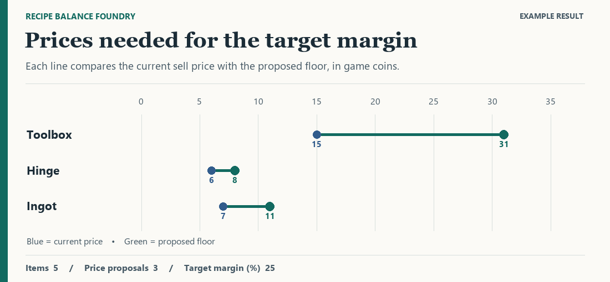
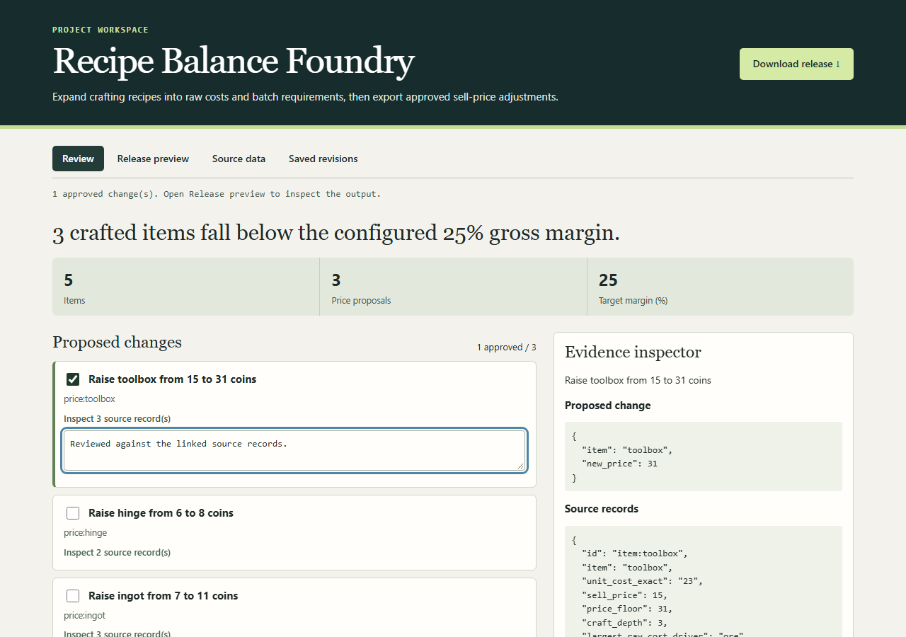

# Recipe Balance Foundry

Expand crafting recipes into raw costs and batch requirements, then export approved sell-price adjustments.

[](https://github.com/oguzhanozfe/recipe-balance-foundry/actions/workflows/check.yml) · [Deploy to Render](https://render.com/deploy?repo=https://github.com/oguzhanozfe/recipe-balance-foundry) · [Input guide](GUIDE.md)

Before changing a crafting price, trace a finished item back to raw ingredients. Compare its unit cost with the materials needed to make a whole batch.



## Try it

With Python 3.11+ installed, clone this repository and run:

```sh
git clone https://github.com/oguzhanozfe/recipe-balance-foundry.git
cd recipe-balance-foundry
python app.py
```

Open <http://127.0.0.1:8000>. The synthetic example is loaded. Select a proposed change, inspect its source records, and open **Release preview** to see the resulting files. Choose **Download release** to save them.

## Walk through the example

A designer prices individual items, but crafting often operates in batches. This workflow exposes both views. Raw items declare a purchase cost. Crafted items declare ingredients, quantities, a batch yield and a per-batch fee. All prices are in whole coins. The example shares ingots between hinges and toolboxes.

**What the engine finds.** 3 crafted items fall below the configured 25% gross margin.

**Try this decision.** Approve **Raise toolbox from 15 to 31 coins**. The [example review](docs/example-review.json) lists the supporting record IDs and the checksum of each exported file. Its native outputs are [`economy-prices.csv`](docs/example-release/economy-prices.csv), [`production-order.csv`](docs/example-release/production-order.csv).

Reproduce that release at the command line:

```sh
python app.py analyze example.json
python app.py export example.json --approve "price:toolbox" --out reviewed.zip
```

## Model-assisted review

With a local model in Ollama or LM Studio, Azure OpenAI, Amazon Bedrock, or a compatible API connected, select **Request suggestions**. The model examines up to eight candidate actions. Each displayed suggestion links to one of that action's source records. Approving a change and recording a review note remain explicit reviewer actions.

The app runs locally with Python's standard library. The Docker image includes the Bedrock SDK and the production web server. The same UI can save immutable revisions, reopen a workspace and compare decisions. See [model settings, Docker deployment and the HTTP API](docs/deployment.md).



## Development

The domain algorithm and exporter live in [pipeline.py](pipeline.py). The [method guide](GUIDE.md) describes its input assumptions and limitations. Install test dependencies and run the suite:

```sh
python -m pip install -r requirements.txt
python -m unittest discover -v
```

[MIT license](LICENSE)
